# AlertStack OT

### OT/ICS Security Monitoring and Detection Platform

AlertStack OT is a self-hosted OT/ICS security monitoring and detection project designed to collect, normalize, correlate and assess Modbus TCP write activity observed by network security sensors.

The project combines Suricata, Zeek, FastAPI, Python and SQLite to build a centralized view of OT network activity, with Grafana providing security monitoring dashboards.

The lab uses Conpot as a simulated industrial control system target to generate and observe OT protocol activity.

---

## 1. Project objectives

The main objectives are to:

- Monitor Modbus TCP activity in a simulated OT environment.
- Collect network security events from Suricata and Zeek.
- Normalize different sensor formats into a common event structure.
- Identify duplicate observations across sensors.
- Detect repeated Modbus write activity.
- Calculate explainable, heuristic risk scores.
- Store raw and normalized events for investigation.
- Visualize OT security activity through Grafana.

## Architecture

<p align="center">
  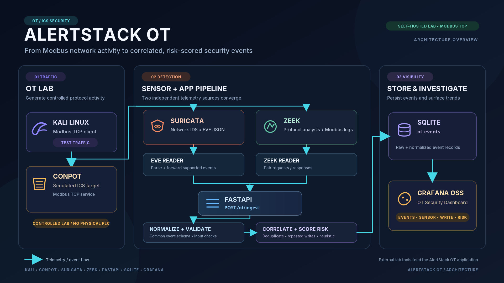
</p>

### Components

| Component | Responsibility |
|---|---|
| Conpot | Simulates an industrial control system |
| Kali Linux | Generates Modbus TCP test traffic |
| Suricata | Inspects network traffic and generates EVE JSON events |
| Zeek | Produces protocol-level Modbus logs |
| Suricata reader | Follows EVE JSON and delivers supported events |
| Zeek reader | Pairs Modbus requests and responses and delivers events |
| FastAPI | Provides the event ingestion API |
| Normalization | Converts sensor data into a common event structure |
| Correlation | Identifies duplicate observations and repeated activity |
| Risk engine | Calculates explainable heuristic risk scores |
| SQLite | Persists raw and normalized events |
| Grafana | Visualizes OT security activity |

**Important:** AlertStack OT does not directly control PLCs, run Conpot, or operate the Suricata and Zeek sensor engines. These are external lab components.

## 3. Technology stack

- Python
- FastAPI
- Uvicorn
- SQLite
- Suricata
- Zeek
- Conpot
- Modbus TCP
- Grafana OSS
- Linux
- Pytest
- HTTPX

## 4. Repository structure

```text
alertstack-ot/
│
├── app/
│   ├── api/
│   │   └── ot_ingestion.py
│   │
│   ├── db/
│   │   └── database.py
│   │
│   ├── ot/
│   │   ├── analysis/
│   │   │   └── engine.py
│   │   │
│   │   ├── correlation/
│   │   │   └── engine.py
│   │   │
│   │   ├── ingestion/
│   │   │   ├── eve_reader.py
│   │   │   └── zeek_reader.py
│   │   │
│   │   ├── normalization/
│   │   │   ├── suricata.py
│   │   │   └── zeek.py
│   │   │
│   │   ├── risk/
│   │   │   └── engine.py
│   │   │
│   │   └── repository.py
│   │
│   ├── tests/
│   │   ├── unit/
│   │   └── integration/
│   │
│   └── main.py
│
├── data/
├── .env.example
├── .gitignore
└── requirements.txt
```

## 5. Installation

### Prerequisites

The lab requires:

- Linux host with Python 3.10 or newer.
- A working Python virtual environment.
- Suricata with EVE JSON logging enabled.
- Zeek with Modbus protocol logging enabled.
- Conpot or another authorized Modbus test target.
- Grafana OSS for dashboard visualization.

These are external lab dependencies, not all Python dependencies are installed through `requirements.txt`.

### Clone the repository

```bash
git clone https://github.com/Meraj1312/alertstack-ot.git
cd alertstack-ot
```

### Create a virtual environment

```bash
python3 -m venv .venv
source .venv/bin/activate
```

### Install Python dependencies

```bash
pip install -r requirements.txt
```

The pinned application dependencies are:

```text
fastapi==0.111.0
uvicorn[standard]==0.30.1
httpx==0.27.0
pytest==8.2.2
```

## 6. Configuration

Create the environment configuration file:

```bash
cp .env.example .env
```

Default configuration:

```dotenv
ALERTSTACK_OT_INGEST_URL=http://127.0.0.1:8000/ot/ingest

SURICATA_EVE_PATH=/var/log/suricata/eve.json

ZEEK_MODBUS_LOG_PATH=/opt/zeek/logs/current/modbus.log

ZEEK_CHECKPOINT_PATH=data/zeek_reader_checkpoint.json

ALERTSTACK_OT_POLL_INTERVAL=0.5
ALERTSTACK_OT_HTTP_TIMEOUT=5.0
ALERTSTACK_OT_MAX_RETRIES=5
ALERTSTACK_OT_RETRY_INTERVAL=2.0
```

Adjust paths according to the local sensor installation.

The database path can optionally be configured using:

```dotenv
ALERTSTACK_OT_DB_PATH=data/alertstack.db
```

**Load the environment variables before starting the application or readers:**

```bash
set -a
source .env
set +a
```

The application does not automatically load `.env`.

The sensor readers also need permission to read their respective log files. Configure appropriate file ownership, group permissions or access controls rather than unnecessarily running the entire application as root.

## 7. Running AlertStack OT

### Start the API

From the project directory, with the virtual environment activated and environment variables loaded:

```bash
uvicorn app.main:app --host 127.0.0.1 --port 8000
```

The API initializes the SQLite database during application startup.

### Health endpoint

```text
GET /health
```

Expected response:

```json
{
  "status": "healthy",
  "service": "alertstack-ot"
}
```

### API documentation

Open:

```text
http://127.0.0.1:8000/docs
```

### OT ingestion endpoint

```text
POST /ot/ingest
```

The endpoint accepts Suricata EVE events and normalized Zeek OT events.

Unsupported events are ignored, invalid supported Zeek events are rejected, and duplicate events are identified.

### Start the Suricata reader

In another terminal:

```bash
cd ~/alertstack-ot
source .venv/bin/activate

set -a
source .env
set +a

python -m app.ot.ingestion.eve_reader
```

The reader follows new EVE records and sends supported Modbus write events to the API.

It starts at the end of the existing EVE file, avoiding historical event replay on its first start.

Failed deliveries remain queued and are retried before new records are consumed.

### Start the Zeek reader

In another terminal:

```bash
cd ~/alertstack-ot
source .venv/bin/activate

set -a
source .env
set +a

python -m app.ot.ingestion.zeek_reader
```

The Zeek reader:

- Follows the active Modbus log.
- Pairs requests and responses using connection UID and transaction ID.
- Expires unanswered requests after a timeout.
- Persists pending transactions and queued deliveries.
- Uses checkpoints to resume reading.
- Detects active log-file replacement.

Both readers require access to the sensor log files and a running API endpoint.

## 8. Event normalization

AlertStack OT converts Suricata and Zeek observations into a common internal event structure.

Supported Modbus write function codes:

| Function code | Operation |
|---|---|
| 5 | Write Single Coil |
| 6 | Write Single Register |
| 15 | Write Multiple Coils |
| 16 | Write Multiple Registers |
| 22 | Mask Write Register |

### Suricata normalization

The Suricata normalizer extracts:

- Source and destination endpoints.
- Modbus transaction details.
- Function code and operation.
- Unit ID.
- Response status.
- Alert signature and severity.
- Register address and write data when available.

For FC16, the normalizer can decode register data into 16-bit values when the supplied data matches the reported register count.

### Zeek normalization

The Zeek normalizer:

- Parses Zeek TSV metadata.
- Extracts supported write requests.
- Pairs requests with responses.
- Determines whether the response was received, unknown or an exception.
- Extracts endpoint and transaction information.

The standard Zeek Modbus log does not expose register addresses or written values, so these fields are intentionally omitted.

## 9. Correlation engine

The correlation engine identifies duplicate sensor observations and repeated Modbus write activity.

### Duplicate observation detection

Default duplicate window:

```text
2 seconds
```

Transaction identity considers:

- Source IP and port.
- Destination IP and port.
- Modbus transaction ID.
- Function code.
- Unit ID.
- Operation.

Sensor identity and alert signature are excluded, allowing observations from different sensors to be grouped.

Optional register details are compared when available. Conflicting known details prevent a duplicate match.

### Repeated activity detection

Default configuration:

| Parameter | Value |
|---|---:|
| Repeated activity window | 60 seconds |
| Minimum distinct transactions | 3 |

Repeated activity is counted using distinct transaction groups rather than individual IDS alerts.

Overlapping qualifying windows are merged into activity groups.

## 10. Risk assessment

The risk engine enriches normalized events with an explainable heuristic assessment.

### Scoring model

| Condition | Score |
|---|---:|
| Modbus write attempt | +25 |
| Protocol response received | +5 |
| Protocol response unknown | +10 |
| Protocol exception | +0 |
| Repeated activity | +15 |

Maximum score: 100.

### Severity classification

| Score | Severity |
|---|---|
| 0–24 | Informational |
| 25–49 | Low |
| 50–74 | Medium |
| 75–89 | High |
| 90–100 | Critical |

Each risk assessment contains:

- Score.
- Severity.
- Score version.
- Individual scoring reasons.

The model is an initial heuristic, not a validated industrial risk model. A protocol response does not establish that a physical process changed, and a detected write attempt does not prove successful process manipulation.

## 11. Database and persistence

AlertStack OT uses SQLite.

Default database:

```text
data/alertstack.db
```

Main table:

```text
ot_events
```

The table stores:

- Event identifier.
- Original timestamp.
- Sensor.
- Event type.
- Protocol.
- Source and destination endpoints.
- Sensor-provided severity.
- Original raw event.
- Normalized and enriched event.
- Database creation timestamp.

SHA-256 hashes of the serialized original event are used as event identifiers.

Duplicate inserts are prevented using SQLite's `INSERT OR IGNORE` behaviour.

Indexes are created for timestamp and event type.

Risk and correlation results are persisted inside the normalized event data.

## 12. Grafana dashboard

The Grafana dashboard is named:

**AlertStack - OT Security Monitoring**

It uses the `AlertStack-OT-SQLite` data source.

The dashboard currently includes four monitoring panels:

1. Total OT Events
2. Events by Sensor
3. Modbus Write Activity Over Time
4. OT Risk Severity Distribution

The dashboard provides a visual overview of collected events, sensor activity, Modbus write operations and calculated risk classifications.

Grafana and its SQLite data-source plugin are configured separately from the Python application.

## 13. Live Modbus validation

The lab was validated using Kali Linux as a Modbus TCP client and Conpot as the simulated OT target.

A Modbus register write was performed against the simulated target:

```python
client.write_register(
    address=40001,
    value=789,
    slave=2
)
```

The register was subsequently read:

```python
client.read_holding_registers(
    address=40001,
    count=1,
    slave=2
)
```

Validation result:

```text
[PASS] Connected to Conpot
WRITE: WriteRegisterResponse 40001 => 789
READ: ReadHoldingRegistersResponse (1)
Readback: 789
[PASS] SUCCESS
```

The corresponding Modbus activity was observed in Zeek's Modbus log, including write and read request/response records.

Suricata also recognized and processed Modbus traffic on the monitored OT network interface.

This demonstrates the collection and observation of Modbus activity in a controlled simulation. It does not demonstrate control of a real industrial process.

## 14. Testing

Run the test suite:

```bash
python -m pytest -q app/tests
```

Latest recorded result:

```text
108 passed, 2 warnings
```

The warnings were dependency deprecation warnings, not test failures.

The project includes unit and integration tests covering the OT ingestion, normalization, correlation, risk and persistence components.

## 15. Current scope and limitations

- The current implementation focuses on Modbus TCP write activity.
- It does not provide complete coverage of all Modbus functions.
- Suricata and Zeek operate as external sensors.
- Conpot is a simulated target, not a physical PLC or production control system.
- The risk engine uses initial heuristic scoring.
- Risk scores do not establish physical impact or process safety.
- Zeek's standard Modbus logs do not provide all register-level details.
- The current readers follow configured active log files and use their respective retry/checkpoint mechanisms.
- Grafana dashboard configuration is maintained separately from the application source.

## 16. Future development

Potential areas for further development include:

- Additional OT protocol support.
- DNP3 monitoring.
- Improved asset and device context.
- More advanced OT-specific detection logic.
- Configurable risk policies.
- Improved event investigation and reporting.
- Detection rule testing and validation.
- Additional dashboard visualizations.
- Production-oriented deployment and operational hardening.

---

## Project status

AlertStack OT is a self-hosted OT/ICS security monitoring project validated in a controlled lab environment using simulated Modbus TCP activity.

The project demonstrates practical work with network security monitoring, OT protocol analysis, event normalization, cross-sensor correlation, heuristic risk assessment and security event visualization.

**Environment:** Linux, Kali Linux, Conpot, Suricata, Zeek, FastAPI, SQLite and Grafana OSS.

**Author:** Mohammad Meraj

**GitHub:** https://github.com/Meraj1312

## 17. Evidence and Screenshots

The following screenshots document the implementation, configuration, testing and live OT protocol validation performed in the lab.

### API and monitoring dashboard

**FastAPI documentation**

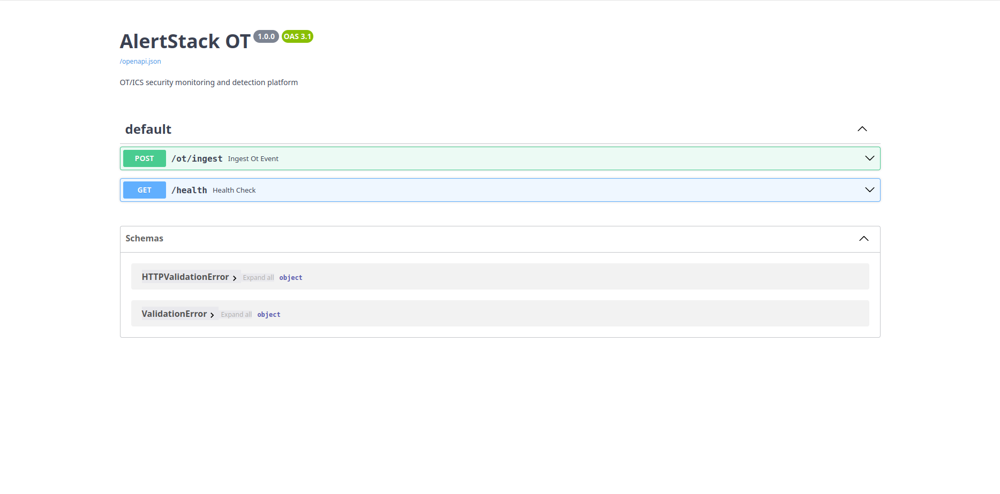

Swagger UI showing the available `/ot/ingest` and `/health` endpoints.

**Grafana monitoring dashboard**

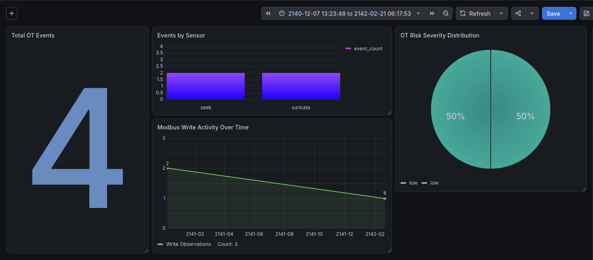

Grafana dashboard showing:
- Total OT Events: 4
- Events by Sensor bar chart
- Modbus Write Activity Over Time line chart
- OT Risk Severity Distribution pie chart

### Sensor health and statistics

**Suricata statistics**

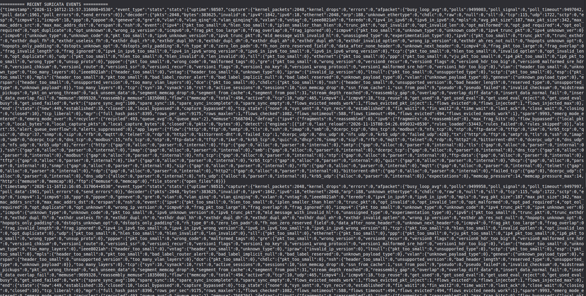

Raw Suricata statistics and recent event information, including protocol-processing counters.

**Suricata service status**

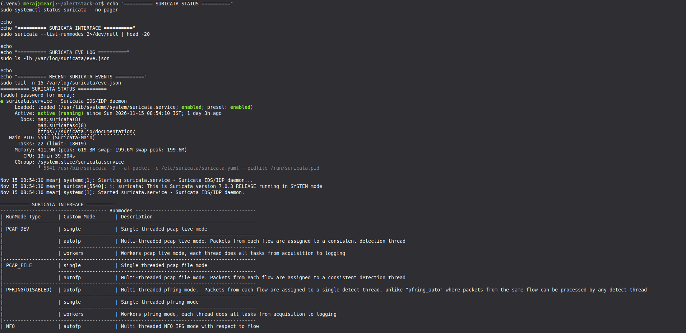

Terminal evidence showing Suricata's `active (running)` service status and runmode information.

### Modbus TCP validation

**Kali-to-Conpot Modbus test**

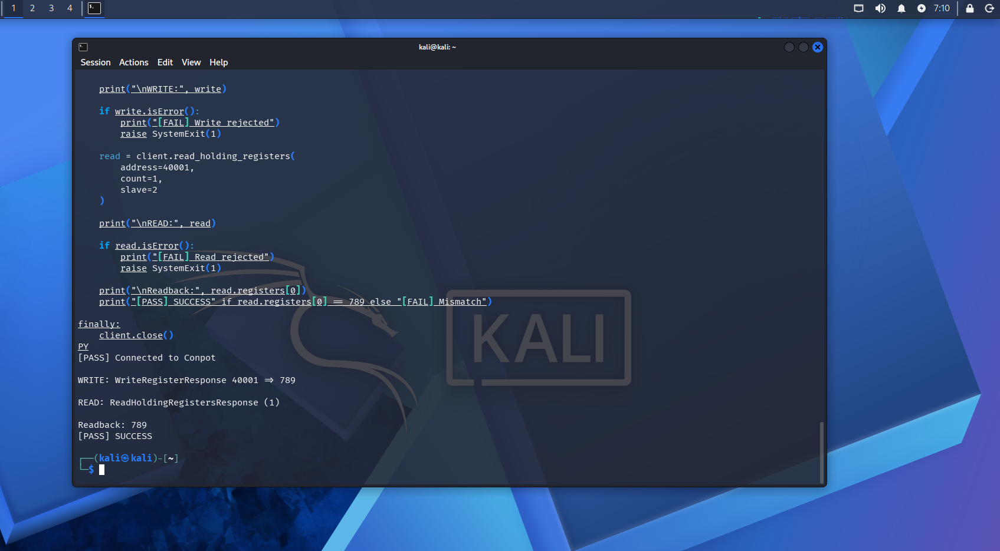

Successful Modbus TCP register write and readback against the simulated Conpot target. The test confirms the written value `789` was read back successfully.

### Zeek protocol monitoring

**Live Zeek Modbus evidence**

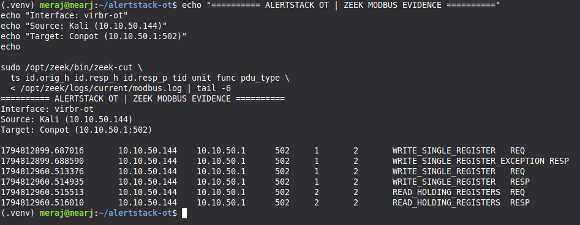

Decoded Zeek Modbus records showing traffic involving the Kali client at `10.10.50.144`.

**Zeek live monitoring**

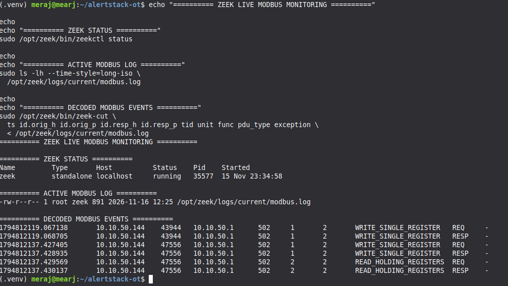

Zeek service status and decoded events from the active Modbus log.

**Historical Zeek Modbus evidence**

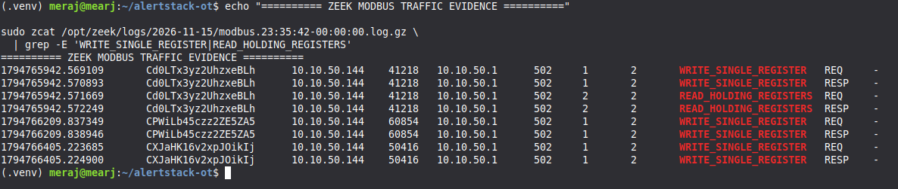

Historical Modbus request and response records from the archived Zeek log dated November 15, 2026.

### OT network configuration

**OT monitoring interface**

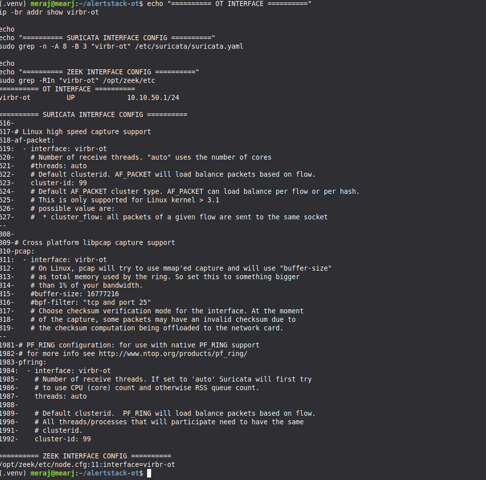

Evidence showing the `virbr-ot` interface at `10.10.50.1/24`, alongside the Suricata and Zeek interface configuration.

### Automated test results

**Pytest results**

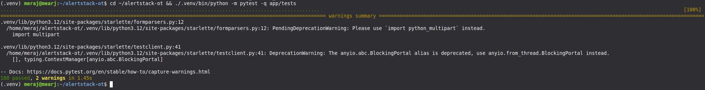

Latest recorded test execution: **108 passed, 2 warnings in 1.45 seconds**.
